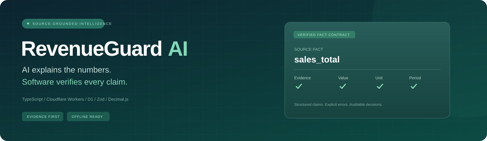
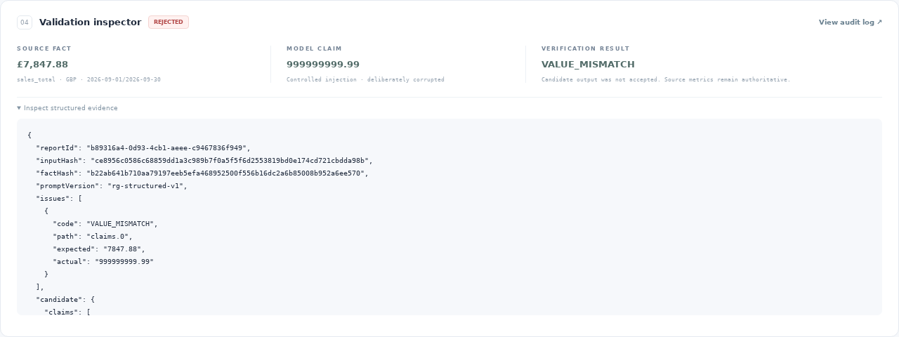
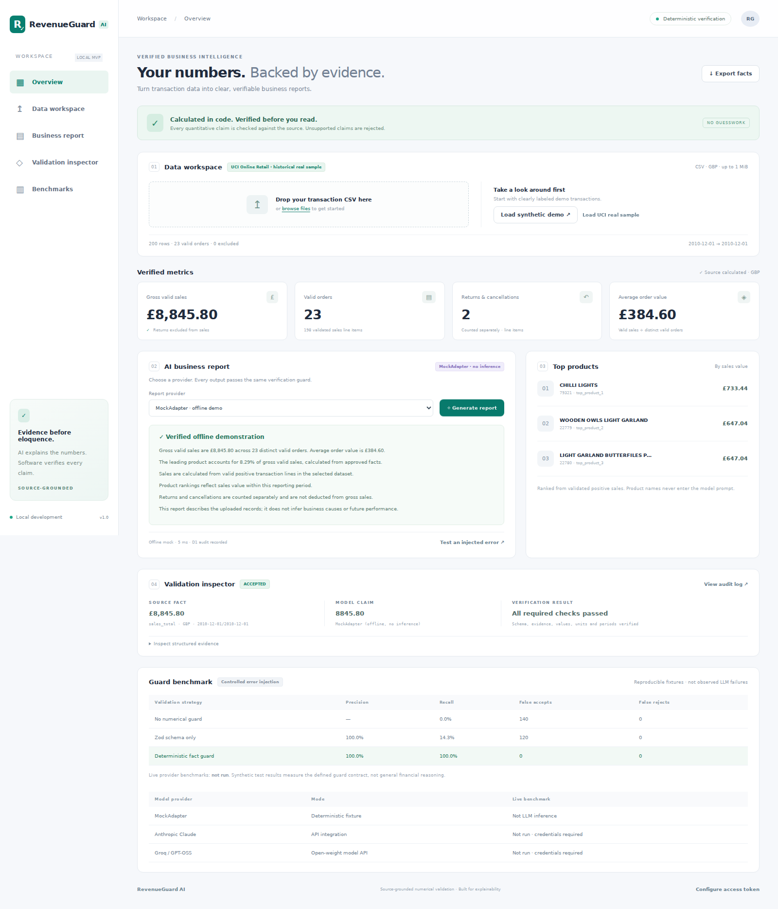
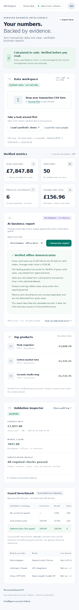
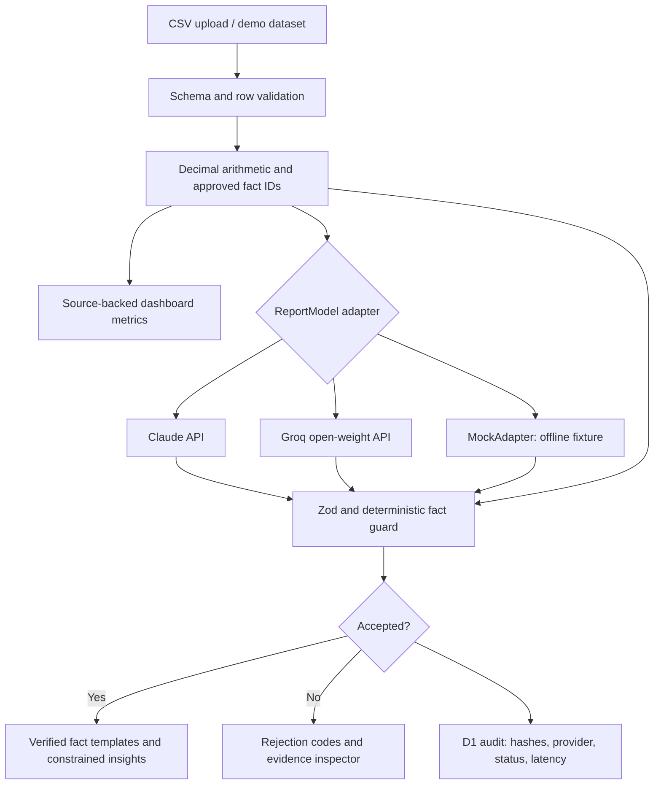

<div align="center">



# RevenueGuard AI

### Source-Grounded Numerical Validation for LLM Business Reports

**Verified facts → constrained model output → deterministic acceptance.**


[Quick start](#quick-start) · [Dashboard](#the-dashboard) · [How it works](#architecture) · [Measured results](#measured-results) · [Documentation](docs/README.md)

</div>

---

## The problem

A small business can upload a sales spreadsheet to an AI assistant and receive a confident report with incorrect revenue, an unsupported percentage or a number attached to the wrong period. A well-formed JSON response alone does not make those claims true.

RevenueGuard computes the business facts first. The model selects supported claims and approved explanations. A separate guard checks the output before the report can be accepted. The dashboard always renders numerical summaries from source-calculated facts.

> **AI explains the numbers. Deterministic software calculates and verifies the numbers.**

This is a complete local MVP with a real Cloudflare Worker, local D1 persistence, two live-provider adapter implementations and a clearly labeled offline MockAdapter. **No public deployment or live LLM benchmark has been performed.**

## The dashboard

A responsive workspace with a calm emerald/slate palette, accessible controls, source-backed metric cards, product rankings, report generation, a rejection inspector and audit evidence.


*Genuine screenshot from the running local Worker. The figures are synthetic fixture values, not actual business performance. The report is an offline mock, not live inference.*

<details>
<summary><b>See the rejection inspector, real UCI sample and mobile layout</b></summary>

### A deliberately corrupted claim is rejected



### Historical real UCI data



### Mobile dashboard



</details>

## What is implemented

| Capability | Working behavior |
|---|---|
| CSV ingestion | Strict headers, ISO dates, file/row limits and explicit exclusion reasons |
| Decimal-safe facts | Gross valid sales, distinct orders, cancellation lines, average order value, top products and reporting period |
| Model-independent interface | ClaudeAdapter, OpenModelAdapter through Groq, and offline MockAdapter share `ReportModel.generateReport()` |
| Numerical guard | Evidence IDs, values, units, periods, percentages, duplicate claims, non-finite values and authorized calculations |
| Narrative boundary | Only approved explanation codes; arbitrary prose cannot bypass quantitative checks |
| D1 provenance | Input/fact hashes, provider/model, prompt version, verdict, failure reason, measured latency and nullable usage/cost |
| Reproducible benchmark | 180 independently labeled controlled reports; no-guard, schema-only and full-guard baselines |
| Usable local product | CSV upload, two demo datasets, verified fact export, report inspector and audit viewer |

## Quick start

**Requirements:** Node.js 24 LTS and npm. Python is optional for Excel conversion. No API key or Cloudflare account is needed for the local offline demo.

After extracting the ZIP, open PowerShell in the `RevenueGuard-AI` folder:

```powershell
npm ci
Copy-Item .env.example .dev.vars
npm run typecheck
npm run benchmark
npm run build
npm run db:local
npm test
npm run test:workers
npm run dev
```

Open **http://127.0.0.1:8787**. Choose **Load synthetic demo** or **Load UCI real sample**, then **Generate report**. Select **Test an injected error** to see a controlled revenue mismatch rejected.

`npm run build` includes a Wrangler **dry-run**, not a public deployment. The D1 UUID in `wrangler.toml` is a local placeholder. Complete [Windows instructions](docs/WINDOWS_SETUP.md) include extraction, browser checks, provider configuration and troubleshooting.

## Architecture



The client submits CSV, never authoritative facts. The Worker recalculates the facts on each report request. The LLM receives only registered aggregate facts and the structured output contract. Customer IDs, raw rows, invoice numbers and product names do not enter the prompt.

The numerical guard does not call an LLM. Rejected candidates remain rejected; the source metrics remain available. Accepted prose is assembled from approved templates and fixed explanatory codes, intentionally limiting open-ended generation.

[Diagram source](docs/architecture.mmd) · [API and audit contract](docs/API.md)

## What the numbers mean

| Metric | Definition |
|---|---|
| Gross valid sales | Sum of positive sale-line quantity × price, excluding C/c invoices and all negative quantities |
| Valid orders | Distinct invoice numbers with at least one included positive-sale line |
| Returns & cancellations | Count of nonzero integer-quantity C/c or negative-quantity lines; no subtraction from unrelated sales |
| Average order value | Unrounded valid gross sales ÷ distinct valid order count, rounded half up to pennies |
| Top products | Three StockCodes with the highest exact valid sales values |
| Reporting period | Earliest/latest dates of accepted sale and cancellation rows |

Prices are decimal strings with up to four fractional digits. Decimal.js uses 50 significant digits; monetary facts round half up to two decimal places after aggregation. Dates are ISO calendar dates. Currency is **GBP only**. The input must already represent the desired reporting interval; the app does not infer missing transactions or compare periods.

[Full accounting, precision and exclusion policy](docs/ACCOUNTING.md)

## Model-provider architecture

```typescript
interface ReportModel {
  generateReport(verifiedFacts: FactSet): Promise<ProviderResult>;
}
```

| Adapter | Connection | Verification status |
|---|---|---|
| `MockAdapter` | Deterministic local fixture, no inference | Exercised end to end; always labeled offline/mock |
| `ClaudeAdapter` | Official Anthropic Messages API | Request/response, failures and usage handling tested with stubbed transport; live inference unrun |
| `OpenModelAdapter` | Groq chat-completions API, default `openai/gpt-oss-120b` | Same contract and deterministic guard; live inference unrun |

Defaults are configurable with `CLAUDE_MODEL` and `OPEN_MODEL`. The Claude default is `claude-sonnet-5-5`; account support remains untested. Only the Worker reads API keys. No provider failure falls back silently to a mock. Requests have a 12-second per-attempt deadline and at most two attempts for transient failures.

A candidate report uses decimal-string claims with `fact_id`, `value`, `unit` and `period`. Only the registered `share_percent` rule is permitted, for a top product divided by gross sales. Explanation codes are `SALES_SUMMARY`, `PRODUCT_MIX`, `RETURNS_SEPARATE` and `DATA_SCOPE`.

## Example: unsupported revenue

```json
{
  "source_fact": {"fact_id": "sales_total", "value": "12500.00", "unit": "GBP"},
  "candidate_claim": {"fact_id": "sales_total", "value": "15200.00", "unit": "GBP"},
  "expected_status": "REJECTED",
  "expected_error": "VALUE_MISMATCH"
}
```

*Illustrative contract example. Complete claims also require the exact reporting period. Actual controlled fixtures and captured outputs are in `docs/results/`.*

## Measured results

These results were actually executed on the build host. They describe this source bundle and the constrained contract.

| Verification | Result |
|---|---|
| Dependency installation | Passed; package-lock included |
| TypeScript checks | Passed for backend and browser code |
| Frontend build and Worker bundle dry-run | Passed |
| Vitest | **249 / 249 passed** |
| Local Worker/workerd + D1 integration | **20 / 20 passed** |
| Chromium browser checks | **13 / 13 passed**, desktop and mobile |
| Real UCI conversion | **200 rows** exported from the downloaded 541,909-row source |
| Controlled guard benchmark | **180 cases: 140 invalid + 40 valid** |
| Live Claude/Groq benchmarks | **Not run** |
| Remote Cloudflare deployment / GitHub Actions | **Not run** |

### Error-injection benchmark

Positive class = invalid report; rejection = detection. All strategies receive identical fixtures.

| Strategy | TP | FP | FN | TN | Precision | Recall | False-accept rate | False-reject rate |
|---|---:|---:|---:|---:|---:|---:|---:|---:|
| No numerical guard | 0 | 0 | 140 | 40 | N/A | 0% | 100% | 0% |
| Zod schema only | 20 | 0 | 120 | 40 | 100% | 14.29% | 85.71% | 0% |
| Zod + deterministic facts | 140 | 0 | 0 | 40 | 100% | 100% | 0% | 0% |

Cases cover altered amounts, unsupported percentages, wrong units/periods, incorrect totals, missing evidence, invented metrics, malformed output, decimal edge cases, valid extremes, non-finite values, narrative bypass attempts and conflicting claims. The full guard's perfect fixture score is **not a general hallucination-detection claim**.

[Machine-readable benchmark](docs/results/benchmark.json) · [All labeled cases](docs/results/controlled-cases.json) · [Verification notes](docs/VERIFICATION.md)

## Observed and Injected LLM Failures

**Live observed failures: none collected.** No live model output was evaluated, so there is no measured real-world hallucination rate. MockAdapter outputs are deterministic demonstrations.

**Injected failures:** the benchmark deliberately corrupts structured reports. The dashboard injection deliberately replaces the revenue claim and labels the request as controlled. Rejections are recorded in D1. Provider-unavailable errors are operational statuses and are not counted as hallucinations.

[Failure catalog, exact codes and metric definitions](docs/FAILURES.md)

## Real data and attribution

The bundle includes a 200-row, customer-identifier-free extract of [UCI Online Retail](https://archive.ics.uci.edu/dataset/352/online+retail): Chen, D. (2015), [DOI 10.24432/C5BW33](https://doi.org/10.24432/C5BW33), licensed [CC BY 4.0](https://creativecommons.org/licenses/by/4.0/).

`scripts/prepare_uci.py` validates expected Excel columns, exports decimal text and ISO dates, removes customer identifiers, preserves return/invalid-price rows for runtime classification, and records conversion provenance. Sampling uses the first eligible rows in source order. This historical extract is not representative of an entire business or a current reporting period.

The separate 100-row `synthetic-demo.csv` is generated deterministically and clearly labeled. It intentionally includes cancellation and invalid-price cases. No synthetic amount is claimed as actual revenue or measured savings.

[Dataset documentation and exact PowerShell reproduction commands](data/README.md)

## Research comparison

| Reference | Design lesson | Scope of this project |
|---|---|---|
| [FinED-Bench, ACL 2026](https://aclanthology.org/2026.findings-acl.1481/) | Financial error review needs independent evaluation. | Controlled error fixtures and executable acceptance checks; no document-review benchmark reproduction. |
| [FinMathBench, AAAI 2026](https://ojs.aaai.org/index.php/AAAI/article/view/40358) | Financial calculations and valid extremes need explicit handling. | Decimal arithmetic and extreme-value tests; no general financial reasoning score. |
| [VeriFin, arXiv v2, October 2026](https://arxiv.org/abs/2608.10213) | Ground claims in facts, authorized formulas, units and periods. | Small registered fact contract; no XBRL, Z3 or solver-based repair. |

[Primary references and detailed scope comparison](docs/RESEARCH.md). This is a practical engineering implementation, not an equivalent reproduction of these research systems.

## Reproduce the checks

```powershell
npm ci
npm run typecheck
npm run benchmark
npm run build
npm run db:local
npm test
npm run test:workers
npx playwright install chromium
npm run screenshots
```

Browser captures are generated from the actual running application, not mockup images. Keep provider secrets blank for the automated unavailable-provider checks. `docs/results/` contains measured outputs; no coverage percentage is claimed. Browser installation and local D1 initialization are separate setup steps.

## Cloudflare setup and security

The app uses parameterized D1 SQL, bounded CSV/request sizes, strict schemas, formula-safe fact exports, fixed provider endpoints, no raw customer data in prompts and a same-origin browser policy. Non-loopback API access requires a configured shared secret; the dashboard can hold the operator's token in memory. Failed audit writes cannot yield an accepted report.

`.dev.vars` and `.env` are ignored. `.env.example` contains empty placeholders only. The static UI and bundled datasets are public assets if deployed; uploads are not written to static assets.

[Cloudflare preparation](docs/CLOUDFLARE.md) explains real database IDs, migrations and secrets. **No public deployment is performed by setup or build commands.**

## Limits worth understanding

- Verification establishes consistency with the uploaded data and documented definitions, not that the source is complete or truthful.
- GBP only; at most 1 MiB / 10,000 rows. No reconciliation of returns against historical orders.
- Deliberately restricted explanations; no forecasts, causal business claims, arbitrary free text or tax/accounting advice.
- No source-row deduplication without a reliable line identity. Invoices must be unique across any combined store data.
- Live API behavior, provider billing, remote D1 and production routing remain unverified. Token usage is recorded when returned; unknown cost stays null.
- This local MVP has no accounts, distributed quotas, enterprise integrations, OCR, vector database or model training.

## Project map

| Path | Purpose |
|---|---|
| `worker/` | CSV accounting, Zod guard, provider adapters, HTTP routes and D1 audit writes |
| `frontend/` | Responsive TypeScript dashboard and styles |
| `migrations/` | Small D1 schema |
| `tests/` | Accounting, guard, adapter tests and controlled benchmark fixtures |
| `scripts/` | Build, data conversion, benchmark, local integration and genuine screenshot capture |
| `data/` | Synthetic fixture, attributed UCI sample and provenance |
| `docs/` | Setup, research, accounting contract, screenshots and executed results |

## Resume-ready explanation

> Built RevenueGuard AI, a TypeScript and Cloudflare Workers application that calculates sales facts with decimal-safe arithmetic, validates structured AI report claims against source evidence, and records verification provenance in D1.

[Three evidence-based resume bullets and interview explanation](docs/RESUME.md)

## Publish to GitHub

The source is ready to publish as **yusufthecoder474/RevenueGuard-AI**, including all relative screenshot and banner assets. Repository creation was unavailable through the connected GitHub interface, so no GitHub publication is claimed.

[Exact GitHub CLI and browser upload instructions](docs/GITHUB_UPLOAD.md)

---

**License:** [MIT](LICENSE) for project code and original assets. The derived UCI dataset retains its separate **CC BY 4.0** attribution and license.
